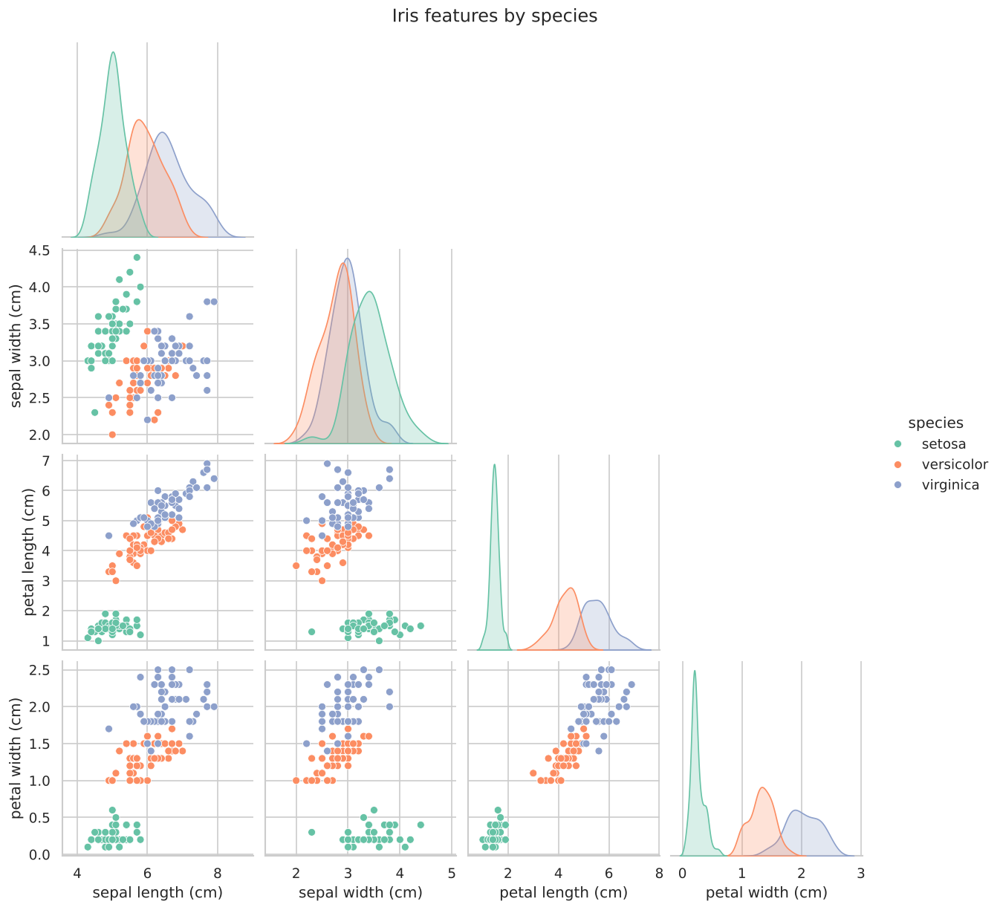
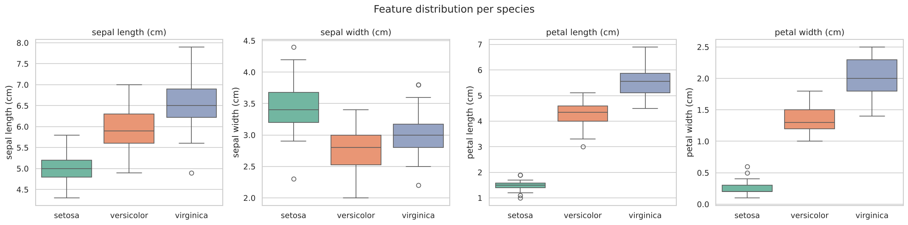
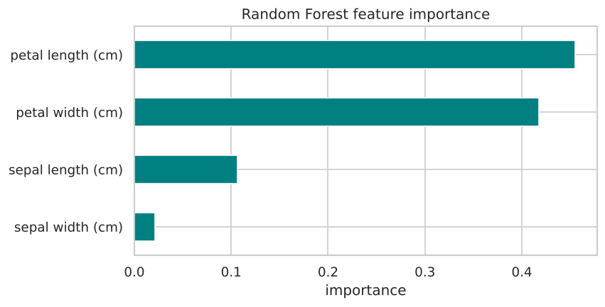
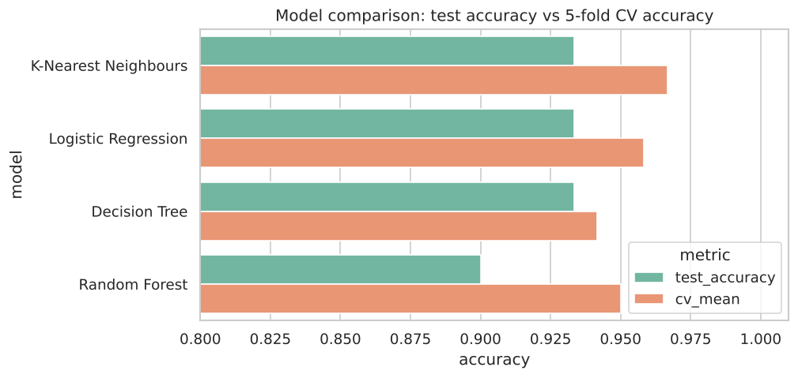
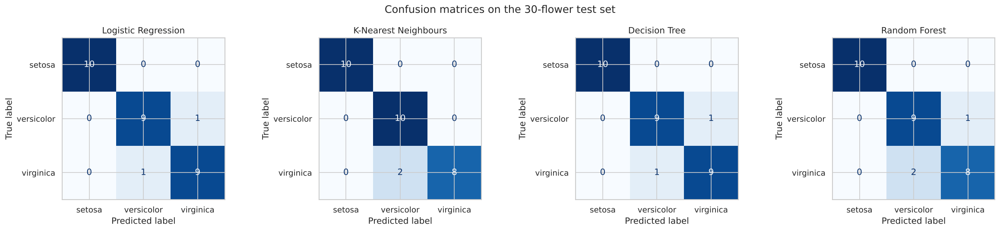

# Iris Flower Classification

**Oasis Infobyte Internship (OIBSIP) · Data Science · Task 1**

A machine learning model that identifies the species of an iris flower (*setosa*, *versicolor* or
*virginica*) from four measurements: sepal length, sepal width, petal length and petal width.

## Dataset

The classic Iris dataset (150 flowers, 50 per species, 4 numeric features), loaded directly with
`sklearn.datasets.load_iris()`, so no download is needed.

## What the notebook does

| Step | Details |
|---|---|
| EDA | Shape, data types, null check, descriptive statistics, per-species means |
| Visualisation | Pairplot by species, box plot per feature, correlation heatmap |
| Feature selection | Visual comparison plus Random Forest feature importance |
| Split | 80/20 stratified `train_test_split` (120 train / 30 test) |
| Models | Logistic Regression, K-Nearest Neighbours, Decision Tree, Random Forest |
| Evaluation | Accuracy, confusion matrix, classification report (precision, recall, F1), 5-fold CV |
| Result | Best model chosen and justified |

## Results

| Model | Test accuracy | 5-fold CV accuracy |
|---|---|---|
| **K-Nearest Neighbours** | **0.933** | **0.967 ± 0.031** |
| Logistic Regression | 0.933 | 0.958 ± 0.026 |
| Decision Tree | 0.933 | 0.942 ± 0.020 |
| Random Forest | 0.900 | 0.950 ± 0.017 |

- **Petal length and petal width** are the most informative features; sepal width is the least.
- **Setosa** is always classified perfectly. Every error is a *versicolor/virginica* mix-up, the two species
  whose petal sizes overlap.
- **Best model: K-Nearest Neighbours (k = 5).** It ties for the top test accuracy and has the highest
  cross-validation accuracy, so it is the most consistent. Logistic Regression is a very close second.

## Outputs

| | |
|---|---|
|  |  |
|  |  |



All files in [`outputs/`](outputs): plots, `model_comparison.csv` and `classification_reports.txt`.

## Project structure

```
DataScience-Task1-IrisFlowerClassification/
├── Iris_Flower_Classification.ipynb   # full, commented notebook with outputs
├── requirements.txt
├── outputs/                           # plots, metrics and reports saved by the notebook
└── README.md
```

## How to run

```bash
pip install -r requirements.txt
jupyter notebook Iris_Flower_Classification.ipynb
```

Run all cells; plots and metrics are written to `outputs/`.

## Tech stack

Python, pandas, NumPy, scikit-learn, matplotlib, seaborn, Jupyter Notebook.
