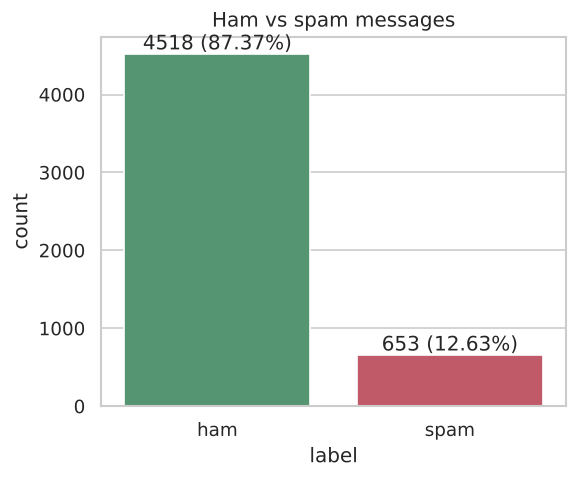
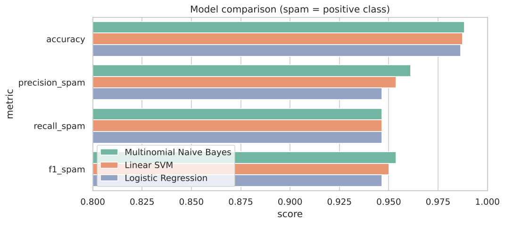
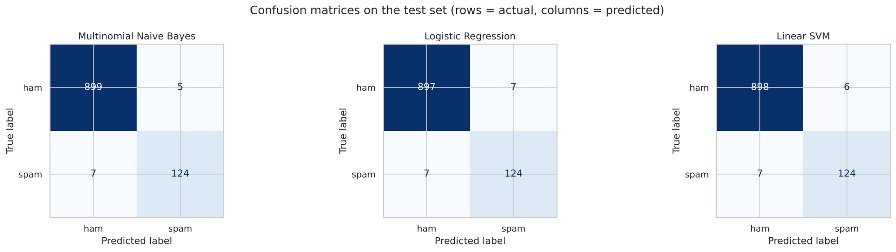
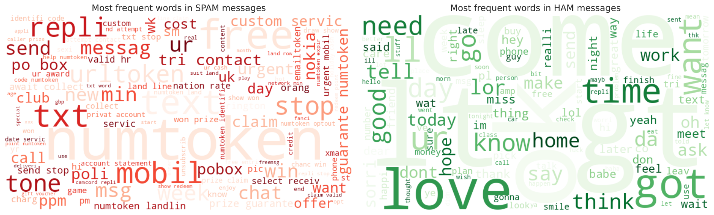

# Email Spam Detection with Machine Learning

**Oasis Infobyte Internship (OIBSIP) · Data Science · Task 4**

🚀 **Live demo:** https://nischay-oibsip-data-science.vercel.app/#spam · 🎬 [Demo video with voice-over](../website/videos/spam.mp4)

An NLP classifier that labels a message as **spam** or **ham** (legitimate), using text preprocessing,
TF-IDF features and Multinomial Naive Bayes, Logistic Regression and a Linear SVM.

## Dataset

The [SMS Spam Collection](https://archive.ics.uci.edu/dataset/228/sms+spam+collection) (UCI, also on
Kaggle): 5,574 English messages labelled `ham` or `spam`, stored in [`data/spam.csv`](data/spam.csv)
with columns `label` and `message`. After removing 403 exact duplicates, 5,171 messages remain:
**87.4% ham, 12.6% spam**.

## What the notebook does

| Step | Details |
|---|---|
| Class distribution | Ham/spam counts and percentages, message-length comparison |
| Preprocessing | Lowercase, replace URLs/emails/phone numbers with tokens, remove punctuation and digits, remove stopwords, Porter stemming |
| Features | TF-IDF (unigrams + bigrams), with a markdown explanation of what TF-IDF measures |
| Split | 80/20 stratified train/test split; TF-IDF fitted on training data only |
| Models | Multinomial Naive Bayes, Logistic Regression, Linear SVM |
| Evaluation | Accuracy, precision, recall, F1, confusion matrices, classification reports |
| Discussion | Why recall matters especially for spam detection |
| Bonus | Word clouds for spam and ham, most spam-indicative terms |

## Results (test set: 1,035 messages)

| Model | Accuracy | Spam precision | Spam recall | Spam F1 |
|---|---|---|---|---|
| **Multinomial Naive Bayes** | **0.988** | **0.961** | **0.947** | **0.954** |
| Linear SVM | 0.987 | 0.954 | 0.947 | 0.950 |
| Logistic Regression | 0.986 | 0.947 | 0.947 | 0.947 |

**Best model: Multinomial Naive Bayes.** It has the highest spam F1 and precision with the same recall
as the others, and is the simplest and fastest to train.

**Why recall matters:** every missed spam message (false negative) reaches the user's inbox, and spam is
the main route for phishing and scams. Because spam is only ~13% of messages, a model can look accurate
while missing a lot of spam, and only recall exposes that. Precision still matters too, since flagging a
real message (such as an OTP) is costly, so models are compared on F1.

## Outputs

| | |
|---|---|
|  |  |




All files in [`outputs/`](outputs): plots, `model_comparison.csv` and `classification_reports.txt`.

## Project structure

```
DataScience-Task4-EmailSpamDetection/
├── Email_Spam_Detection.ipynb   # full, commented notebook with outputs
├── data/spam.csv                # SMS Spam Collection
├── requirements.txt
├── outputs/                     # plots, metrics and reports saved by the notebook
└── README.md
```

## How to run

```bash
pip install -r requirements.txt
jupyter notebook Email_Spam_Detection.ipynb
```

Stopwords come from scikit-learn's built-in English list and stemming uses NLTK's Porter stemmer, so no
NLTK data download is needed.

## Tech stack

Python, pandas, scikit-learn (TF-IDF, Naive Bayes, Logistic Regression, SVM), NLTK, `re`, matplotlib,
seaborn, WordCloud, Jupyter Notebook.
