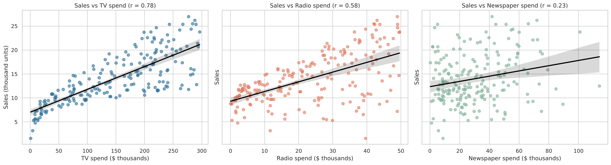
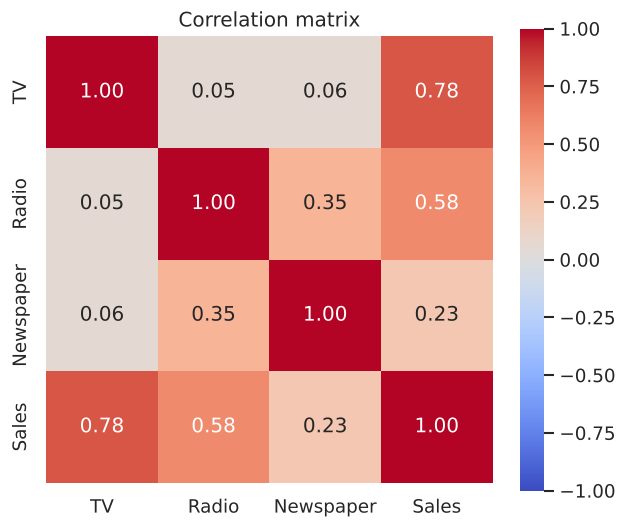
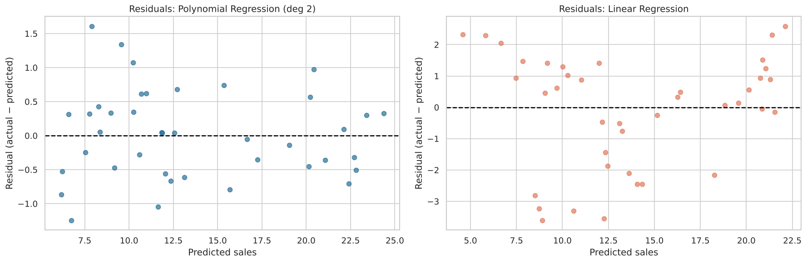
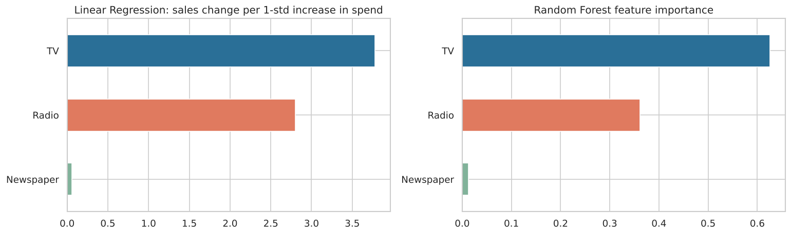

# Sales Prediction Using Python

**Oasis Infobyte Internship (OIBSIP) · Data Science · Task 5**

🚀 **Live demo:** https://nischay-oibsip-data-science.vercel.app/#sales · 🎬 [Demo video with voice-over](../website/videos/sales.mp4)

Predicts product sales from advertising spend on **TV**, **Radio** and **Newspaper**, and identifies which
channel has the greatest impact on sales.

## Dataset

[`data/Advertising.csv`](data/Advertising.csv): 200 markets, from *An Introduction to Statistical
Learning* (also on Kaggle as "Advertising.csv").

| Column | Meaning |
|---|---|
| TV, Radio, Newspaper | Advertising budget in thousands of dollars |
| Sales | Units sold, in thousands |

## What the notebook does

| Step | Details |
|---|---|
| EDA | Null and duplicate check, descriptive statistics, pairplot |
| Scatter plots | Sales vs TV, Radio and Newspaper with fitted lines |
| Correlation | Correlation matrix heatmap |
| Split | 80/20 train/test split |
| Models | Linear Regression (baseline), Polynomial Regression (degree 2), Random Forest Regressor |
| Evaluation | MAE, RMSE, R² on the test set, plus 5-fold CV R² |
| Residuals | Residual plots for the best model vs the baseline; random vs systematic errors |
| Interpretation | Coefficients, standardised coefficients and feature importance per channel |

## Results (test set: 40 markets)

| Model | MAE | RMSE | R² | CV R² |
|---|---|---|---|---|
| **Polynomial Regression (deg 2)** | **0.526** | **0.643** | **0.987** | **0.977** |
| Random Forest | 0.614 | 0.741 | 0.983 | 0.970 |
| Linear Regression (baseline) | 1.461 | 1.782 | 0.899 | 0.859 |

- **Best model: Polynomial Regression.** It explains ~98.7% of the variance in sales. Its residuals are
  small and random, while the linear baseline's residuals form a clear U-shape (a systematic error), because
  a straight line cannot capture diminishing returns or the TV × Radio interaction.

**Which channel matters most?**

| Channel | Sales per extra $1k | Effect of a 1-std increase | RF importance |
|---|---|---|---|
| TV | 0.045 | **3.78** | **0.63** |
| Radio | **0.189** | 2.80 | 0.36 |
| Newspaper | 0.003 | 0.06 | 0.01 |

- **TV has the greatest overall impact** on sales; **Radio is the most effective per dollar**.
- **Newspaper has almost no effect** once TV and Radio are accounted for.
- TV and Radio work together: spending on both lifts sales more than either alone.

## Outputs

| | |
|---|---|
|  |  |
|  |  |

All files in [`outputs/`](outputs): plots, `model_comparison.csv` and `channel_impact.csv`.

## Project structure

```
DataScience-Task5-SalesPrediction/
├── Sales_Prediction.ipynb   # full, commented notebook with outputs
├── data/Advertising.csv
├── requirements.txt
├── outputs/                 # plots and metrics saved by the notebook
└── README.md
```

## How to run

```bash
pip install -r requirements.txt
jupyter notebook Sales_Prediction.ipynb
```

## Tech stack

Python, pandas, NumPy, scikit-learn, matplotlib, seaborn, Jupyter Notebook.
